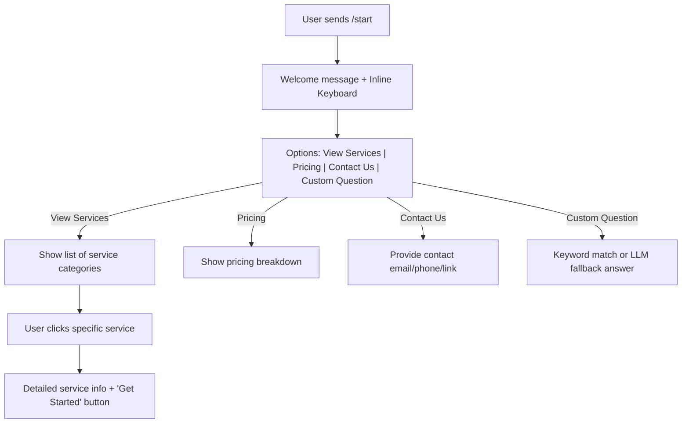

# Telegram Services Bot - Implementation Plan

## 1. Overview
A lightweight Telegram bot designed to greet visitors and answer inquiries regarding offered services, pricing, and contact details, using predefined quick-reply buttons and optional AI fallback.

---

## 2. Architecture & Tech Stack

| Component | Choice | Reason |
| :--- | :--- | :--- |
| **Language** | Python 3.10+ | Fast to develop, rich Telegram bot ecosystem |
| **Telegram Library** | `python-telegram-bot` (v20+) | Fully asynchronous, robust callback & inline button support |
| **Config Management** | `python-dotenv` | Clean `.env` handling for API tokens |
| **Service Catalog** | `services.json` | Easy to update without modifying code |
| **Optional LLM** | OpenAI API / Gemini API | Fallback for free-form questions about services |

---

## 3. Project Directory Structure

```
tele-sales-bot/
├── .env                  # Environment variables (BOT_TOKEN)
├── .env.example          # Template for environment variables
├── .gitignore            # Ignores .env and virtualenv
├── requirements.txt      # Python dependencies
├── services.json         # Service definitions, descriptions, pricing
├── bot.py                # Bot entrypoint & event handlers
└── PLAN.md               # Implementation plan
```

---

## 4. Bot Interaction Flow



---

## 5. Implementation Milestones

### Phase 1: Setup & Environment
- [ ] Initialize git and virtual environment (`python -m venv venv`).
- [ ] Create `requirements.txt` with `python-telegram-bot` and `python-dotenv`.
- [ ] Register bot via Telegram `@BotFather` and obtain `TELEGRAM_BOT_TOKEN`.
- [ ] Create `.env` and `.env.example`.

### Phase 2: Data Modeling (`services.json`)
- [ ] Define service categories, titles, detailed descriptions, pricing, and links in `services.json`.

### Phase 3: Core Bot Handlers (`bot.py`)
- [ ] **`/start` command handler**: Send greeting and display inline menu buttons.
- [ ] **Callback query handlers**: Handle button clicks (`services_list`, `service_detail_<id>`, `pricing`, `contact`).
- [ ] **Service detail view**: Present selected service details with back/contact navigation.
- [ ] **Text message handler**: Catch keywords (e.g., "service", "help", "offer", "price") and route to relevant service information.

### Phase 4: Polish & Error Handling
- [ ] Add logging (`logging` module).
- [ ] Handle unrecognized commands or messages gracefully.
- [ ] Add instructions in `README.md` for running locally and deploying.

---

## 6. Next Steps
1. Create `requirements.txt`.
2. Create `services.json` with initial service details.
3. Implement `bot.py`.
